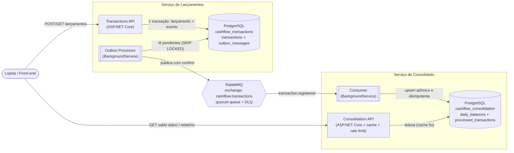
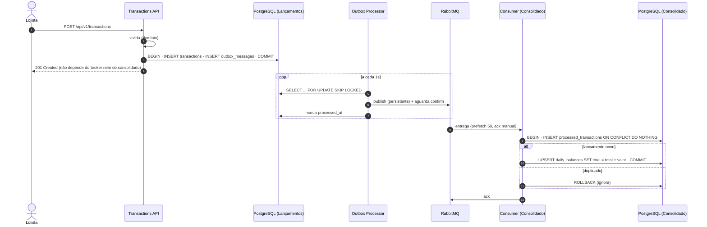
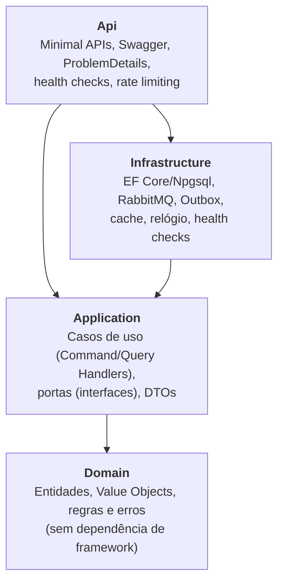

# Fluxo de Caixa: Lançamentos e Consolidado Diário

Solução para o desafio técnico de **Desenvolvedor .NET Sênior**: um lojista registra os créditos e débitos do dia a dia e consulta um relatório com o **saldo consolidado diário**.

A solução tem **dois serviços independentes** que se comunicam **somente por mensageria**:

| Serviço | Responsabilidade | Porta local |
|---|---|---|
| **Transactions API** (Lançamentos) | Registrar e consultar lançamentos (crédito/débito) | `5001` |
| **Consolidation API** (Consolidado) | Manter e servir o saldo consolidado por dia e o relatório por período | `5002` |

> **Stack:** C# / .NET 8 · ASP.NET Core Minimal APIs · EF Core 8 + PostgreSQL 16 · RabbitMQ 3.13 · xUnit · Testcontainers · Docker Compose · k6 · GitHub Actions

---

## Sumário

1. [Como executar](#1-como-executar)
2. [Arquitetura](#2-arquitetura)
3. [Como cada requisito foi atendido](#3-como-cada-requisito-foi-atendido)
4. [Decisões técnicas](#4-decisões-técnicas)
5. [API](#5-api)
6. [Testes](#6-testes)
7. [Estrutura do repositório](#7-estrutura-do-repositório)
8. [Premissas](#8-premissas)
9. [Melhorias futuras](#9-melhorias-futuras)

---

## 1. Como executar

### Pré-requisitos

| Para... | Você precisa de |
|---|---|
| Rodar tudo com containers (recomendado) | [Docker](https://docs.docker.com/get-docker/) com Docker Compose v2 |
| Rodar/depurar as APIs localmente | [.NET SDK 8](https://dotnet.microsoft.com/download/dotnet/8.0) ou superior |
| Testes de integração | .NET SDK 8 + Docker em execução (Testcontainers sobe o PostgreSQL) |
| Teste de carga (opcional) | [k6](https://k6.io/docs/get-started/installation/) |

### Opção A: tudo via Docker Compose

```bash
git clone https://github.com/Jonata-Araujo/fluxo-caixa-dotnet.git
cd fluxo-caixa-dotnet
docker compose up --build -d
```

| Recurso | URL |
|---|---|
| Swagger: Lançamentos | http://localhost:5001/swagger |
| Swagger: Consolidado | http://localhost:5002/swagger |
| Painel do RabbitMQ (guest/guest) | http://localhost:15672 |
| Health checks | `/health/live` e `/health/ready` em cada API |

Os bancos (`cashflow_transactions` e `cashflow_consolidation`) e as tabelas são criados automaticamente na subida.

**Roteiro rápido para ver funcionando** (ou use o arquivo [`requests.http`](requests.http)):

```bash
# 1) Registrar um crédito e um débito
curl -X POST http://localhost:5001/api/v1/transactions -H "Content-Type: application/json" \
     -d '{"type":"credit","amount":1500.00,"description":"Vendas do dia"}'
curl -X POST http://localhost:5001/api/v1/transactions -H "Content-Type: application/json" \
     -d '{"type":"debit","amount":320.45,"description":"Pagamento fornecedor"}'

# 2) Consultar o saldo consolidado de hoje (atualizado de forma assíncrona, em ~1s)
curl http://localhost:5002/api/v1/daily-balances/$(date +%F)
```

**Para comprovar a resiliência** (o requisito principal):

```bash
docker compose stop consolidation-api rabbitmq     # derruba o consolidado E o broker
curl -X POST http://localhost:5001/api/v1/transactions -H "Content-Type: application/json" \
     -d '{"type":"credit","amount":50,"description":"Venda durante a falha"}'   # → 201 Created
docker compose start rabbitmq consolidation-api    # ao voltar, o outbox publica e o saldo é atualizado
```

Resultado observado: com Consolidado e RabbitMQ fora, Lançamentos seguiu `Healthy` e respondeu `201` em cerca de 15 ms; os eventos ficaram pendentes no outbox e, após a volta dos serviços, o saldo foi atualizado em cerca de 12 s, sem perda de eventos.

### Opção B: APIs rodando local (debug), infraestrutura no Docker

```bash
docker compose up -d postgres rabbitmq
dotnet run --project src/Services/Transactions/CashFlow.Transactions.Api      # http://localhost:5001
dotnet run --project src/Services/Consolidation/CashFlow.Consolidation.Api    # http://localhost:5002
```

Ou abra `CashFlow.sln` no Visual Studio/Rider e inicie os dois projetos `*.Api` (múltiplos projetos de inicialização).

### Testes

```bash
dotnet test                                                    # tudo (integração precisa do Docker)
dotnet test --filter "FullyQualifiedName~UnitTests"           # apenas unitários (sem dependências)
dotnet test --filter "FullyQualifiedName~IntegrationTests"    # integração (Testcontainers)
```

### Teste de carga (requisito de 50 req/s)

```bash
docker compose up --build -d
k6 run tests/load/consolidated-balance-50rps.js            # 50 req/s por 1 min, falha < 5%
k6 run -e RATE=150 tests/load/consolidated-balance-50rps.js  # 3x o pico exigido
```

Sem o k6 instalado, rode pela imagem oficial:

```bash
docker run --rm -i grafana/k6 run -e BASE_URL=http://host.docker.internal:5002 - < tests/load/consolidated-balance-50rps.js
```

**Resultados medidos** (Docker Desktop em notebook Windows, 1 minuto por cenário, 80% consultas de dia / 20% relatórios):

| Cenário | Requisições | Falhas | p95 |
|---|---|---|---|
| 50 req/s (pico exigido) | 3.001 | **0%** | 13 ms |
| 150 req/s (3x o pico) | 9.001 | **0%** | 13 ms |
| 50 req/s com cache desligado (`BalanceCache__Enabled=false`) | 2.981 | **0%** | 22 ms |

O cenário sem cache mostra que o requisito é atendido pelo *read model* materializado em si; o cache é uma margem adicional, não a única defesa.

---

## 2. Arquitetura

### 2.1 Visão de containers



Pontos-chave:

- **Nenhuma chamada síncrona entre os serviços.** O único acoplamento é o contrato do evento `TransactionRegisteredIntegrationEvent` (`CashFlow.Contracts`).
- **Banco por serviço (database per service).** Para simplificar o ambiente local os dois bancos ficam na mesma instância do PostgreSQL, mas são bancos lógicos distintos, cada um acessado apenas pelo seu serviço.
- **CQRS entre serviços:** Lançamentos é o *write model*; o Consolidado é um *read model* materializado a partir de eventos, otimizado para leitura.

### 2.2 Fluxo de registro e consolidação



### 2.3 Camadas (Clean Architecture), por serviço



A regra de dependência aponta sempre para dentro: **Domain** não referencia nada além do `SharedKernel`; **Application** define as portas (`ITransactionRepository`, `IIntegrationEventOutbox`, `IDailyBalanceProjection`...) e a **Infrastructure** as implementa (inversão de dependência). Existe um teste automatizado de arquitetura que falha se o domínio ou a aplicação passarem a referenciar EF Core, RabbitMQ, ASP.NET ou a infraestrutura.

---

## 3. Como cada requisito foi atendido

| Requisito | Como foi atendido |
|---|---|
| Serviço de controle de lançamentos | `Transactions API`: registrar (`POST`), consultar por id e listar por dia (paginado). |
| Serviço de consolidado diário | `Consolidation API`: saldo de um dia e relatório por período com saldo de abertura, saldo diário e saldo acumulado. |
| C# | .NET 8 (LTS). |
| Testes | 80+ casos: unitários (domínio, casos de uso, arquitetura) e integração (API + PostgreSQL real via Testcontainers, concorrência, idempotência, política de mensagens, cache). |
| Boas práticas (SOLID, Clean Code, Design Patterns) | Ver [seção 4](#4-decisões-técnicas). |
| README | Este documento + [`docs/decisoes-arquiteturais.md`](docs/decisoes-arquiteturais.md). |
| *(Opcional)* Desenho da solução | Diagramas Mermaid acima (renderizam no GitHub). |
| *(Opcional)* Mensageria/assíncrono | RabbitMQ + Transactional Outbox + consumidor idempotente. |
| *(Opcional)* Containers | Dockerfile multi-stage por API + `docker-compose.yml` com toda a stack. |
| **NFR: lançamentos não pode cair se o consolidado cair** | Nenhuma dependência síncrona. O evento é gravado no **outbox na mesma transação** do lançamento; se o broker ou o consolidado estiverem fora, o `POST` continua respondendo `201` e o evento é publicado quando o broker voltar. O `/health/ready` de Lançamentos depende só do próprio banco. Coberto por teste de integração com o broker inacessível. |
| **NFR: consolidado com 50 req/s e no máximo 5% de perda** | (1) Leitura de um *read model* já materializado: uma busca por chave primária, sem agregação em tempo de consulta. (2) Cache em memória (Decorator, TTL 5s). (3) Pool de conexões dimensionado. (4) **Rate limiting** como *load shedding*: acima de 200 req/s responde `429` rapidamente em vez de degradar tudo. (5) Escrita desacoplada da leitura: picos de lançamentos ficam represados na fila (prefetch), sem competir com as consultas. Validação com script **k6** com *threshold* `http_req_failed < 5%`. |

---

## 4. Decisões técnicas

O detalhamento (contexto, alternativas e trade-offs) está em [`docs/decisoes-arquiteturais.md`](docs/decisoes-arquiteturais.md). Resumo:

| Decisão | Por quê |
|---|---|
| **Dois serviços + mensageria** | É a forma mais direta de cumprir o NFR de disponibilidade: falha do consolidado não se propaga para lançamentos. |
| **Transactional Outbox** | Evita o *dual write* (salvar no banco e publicar no broker sem atomicidade). Garante entrega *at-least-once* sem perder eventos. |
| **Consumidor idempotente** (`processed_transactions`) | *At-least-once* implica duplicatas; a idempotência por `TransactionId` torna o reprocessamento seguro. |
| **Upsert incremental atômico no PostgreSQL** | `ON CONFLICT DO UPDATE SET total = total + delta` elimina *lost updates* sob concorrência sem lock na aplicação e sem retry de concorrência otimista. Testado com 150 atualizações paralelas no mesmo dia. |
| **Quorum queue + `x-delivery-limit` + DLQ** | Falhas transitórias voltam para a fila; mensagens que falham repetidamente, ou inválidas (*poison messages*), vão para a DLQ sem travar o consumo. |
| **Result Pattern** em vez de exceções para regra de negócio | Erros esperados ficam explícitos na assinatura e viram `400/404` com **código de erro estável** (`transaction.amount.non_positive`...). Exceções ficam só para falhas inesperadas (`500` via `IExceptionHandler`). |
| **CQRS "leve" sem MediatR** | Interfaces `ICommandHandler`/`IQueryHandler` resolvidas por DI: explícito, sem reflexão e sem dependência com licença comercial (MediatR e MassTransit mudaram de licença em 2025). |
| **Domínio rico** (`Transaction`, `Money`, `DailyBalance`, `BalanceReport`) | Invariantes protegidas por *factory methods*: um lançamento nunca existe em estado inválido. Lançamentos são imutáveis; correção é por estorno. |
| **`IBusinessClock` + `TimeProvider`** | "Hoje" depende do fuso do lojista (`America/Sao_Paulo`), não do servidor (UTC). Também torna regras de data testáveis. |
| **Minimal APIs + ProblemDetails (RFC 7807)** | Menos cerimônia, ótima performance, contrato de erro padronizado com `traceId`. |
| **EF Core + SQL explícito onde importa** | EF para mapeamento e consultas simples; SQL nos dois pontos críticos de concorrência (outbox com `SKIP LOCKED` e upsert do saldo). |
| **Hand-written fakes** nos testes unitários | Testes focados em comportamento observável, sem acoplamento a detalhes de chamada; nenhuma biblioteca extra. |

**Padrões de projeto aplicados:** Repository, Unit of Work, Transactional Outbox, Decorator (cache), Factory Method (agregados e VOs), Value Object, Result, Strategy de tratamento de mensagens (`MessageDisposition`), Options, Background Worker, Anti-Corruption Layer simplificada (evento → `BalanceMovement`).

**SOLID na prática:**
- **S**: handler por caso de uso; `TransactionRegisteredMessageHandler` (política) separado do `TransactionRegisteredConsumer` (transporte).
- **O**: cache adicionado como Decorator, sem alterar leitor nem casos de uso.
- **L**: `CachedDailyBalanceReader` e `DailyBalanceReader` são intercambiáveis via `IDailyBalanceReader`.
- **I**: portas pequenas e específicas (`IDailyBalanceProjection` para escrita e `IDailyBalanceReader` para leitura).
- **D**: Application depende de abstrações; Infrastructure implementa.

---

## 5. API

### Lançamentos (`http://localhost:5001`)

| Método | Rota | Descrição |
|---|---|---|
| `POST` | `/api/v1/transactions` | Registra um lançamento. Corpo: `{ "type": "credit\|debit", "amount": 10.50, "description": "...", "date": "2026-09-29" }` (`date` opcional, padrão = hoje). |
| `GET` | `/api/v1/transactions/{id}` | Consulta um lançamento. |
| `GET` | `/api/v1/transactions?date=2026-09-29&page=1&pageSize=50` | Lista os lançamentos de um dia (padrão: hoje). |

**Regras de validação:** valor > 0 com no máximo 2 casas decimais; descrição obrigatória (até 200 caracteres); data não pode ser futura (lançamento retroativo é permitido).

Exemplo de erro (`400`):

```json
{
  "type": "https://tools.ietf.org/html/rfc9110#section-15.5.1",
  "title": "Requisição inválida",
  "status": 400,
  "detail": "O valor do lançamento deve ser maior que zero.",
  "code": "transaction.amount.non_positive",
  "traceId": "0HN7..."
}
```

### Consolidado (`http://localhost:5002`)

| Método | Rota | Descrição |
|---|---|---|
| `GET` | `/api/v1/daily-balances/{date}` | Saldo consolidado do dia: créditos, débitos, saldo do dia e quantidade de lançamentos. |
| `GET` | `/api/v1/daily-balances?from=2026-09-01&to=2026-09-30` | Relatório do período (máx. 366 dias): saldo de abertura, uma linha por dia (inclusive dias sem movimento) com saldo acumulado, totais e saldo final. |

```json
{
  "from": "2026-09-28", "to": "2026-09-29",
  "openingBalance": 10000.00, "totalCredits": 1500.00, "totalDebits": 320.45, "closingBalance": 11179.55,
  "days": [
    { "date": "2026-09-28", "totalCredits": 0, "totalDebits": 0, "netBalance": 0, "transactionCount": 0, "closingBalance": 10000.00 },
    { "date": "2026-09-29", "totalCredits": 1500.00, "totalDebits": 320.45, "netBalance": 1179.55, "transactionCount": 2, "closingBalance": 11179.55 }
  ]
}
```

> **Consistência eventual:** o saldo reflete um lançamento normalmente em cerca de 1 segundo (intervalo do outbox + processamento), somado ao TTL do cache (5s). Para um relatório de fluxo de caixa esse atraso é aceitável e é o que permite isolar os serviços. Os valores são configuráveis em `appsettings.json`.

---

## 6. Testes

| Projeto | Tipo | O que cobre |
|---|---|---|
| `CashFlow.Transactions.UnitTests` | Unitário | `Money`, `Transaction`, parser de tipo, `RegisterTransactionHandler` (persistência + outbox na mesma unidade de trabalho, nada é salvo em caso de erro), queries/paginação e **testes de arquitetura** (regra de dependência). |
| `CashFlow.Consolidation.UnitTests` | Unitário | `DailyBalance`, `BalanceMovement`, `BalanceReport` (dias sem movimento, saldo acumulado, limites de período), idempotência do caso de uso, queries com *fail fast*. |
| `CashFlow.Transactions.IntegrationTests` | Integração | API real + PostgreSQL (Testcontainers): 201/400/404, ProblemDetails com código de erro, listagem e **registro com o RabbitMQ inacessível** (evento fica pendente no outbox e a falha é registrada). |
| `CashFlow.Consolidation.IntegrationTests` | Integração | Upsert real no PostgreSQL: incremento, **idempotência**, **150 atualizações concorrentes no mesmo dia sem perda**, **20 duplicatas concorrentes aplicadas uma única vez**, endpoints, política ack/requeue/DLQ e cache. |
| `tests/load` | Carga (k6) | 50 req/s no consolidado com *threshold* de falha < 5% e p95 < 300 ms. |

Convenção de nomes: `Metodo_Cenario_ResultadoEsperado`, com estrutura *Arrange / Act / Assert*.

O pipeline de CI (`.github/workflows/ci.yml`) roda build, testes unitários (com cobertura) e testes de integração a cada push/PR.

---

## 7. Estrutura do repositório

```
├── src
│   ├── BuildingBlocks
│   │   ├── CashFlow.SharedKernel        # Result, Error, Entity, CQRS interfaces, TransactionType
│   │   ├── CashFlow.Contracts           # Evento de integração + topologia RabbitMQ (contrato entre serviços)
│   │   └── CashFlow.Web.Common          # ProblemDetails, exception handler, health endpoints
│   └── Services
│       ├── Transactions                 # Serviço de Lançamentos
│       │   ├── CashFlow.Transactions.Domain
│       │   ├── CashFlow.Transactions.Application
│       │   ├── CashFlow.Transactions.Infrastructure   # EF Core, Outbox, RabbitMQ publisher
│       │   └── CashFlow.Transactions.Api
│       └── Consolidation                # Serviço de Consolidado
│           ├── CashFlow.Consolidation.Domain
│           ├── CashFlow.Consolidation.Application
│           ├── CashFlow.Consolidation.Infrastructure  # Projeção, consumer, cache
│           └── CashFlow.Consolidation.Api
├── tests
│   ├── CashFlow.Transactions.UnitTests
│   ├── CashFlow.Transactions.IntegrationTests
│   ├── CashFlow.Consolidation.UnitTests
│   ├── CashFlow.Consolidation.IntegrationTests
│   └── load/consolidated-balance-50rps.js
├── docs/decisoes-arquiteturais.md
├── docker-compose.yml
├── requests.http
├── Directory.Build.props / Directory.Packages.props   # configs e versões centralizadas
└── .github/workflows/ci.yml
```

---

## 8. Premissas

- **Um único lojista** (single-tenant), conforme o enunciado. A evolução para multi-tenant está nas melhorias.
- **Saldo diário** = créditos − débitos do dia. O relatório também traz o **saldo acumulado** (abertura + movimentos), que é o que normalmente se espera de um fluxo de caixa.
- **Data de competência** (`date`) é informada pelo lojista ou assume "hoje" no fuso `America/Sao_Paulo`. Lançamentos retroativos são aceitos e consolidados no dia correto; datas futuras são rejeitadas.
- **Lançamentos são imutáveis.** Correção se faz com um lançamento de estorno (trilha de auditoria preservada).
- Autenticação/autorização ficaram fora do escopo do desafio (ver melhorias).

---

## 9. Melhorias futuras

Itens que eu priorizaria em um cenário de produção, em ordem aproximada:

1. **Segurança:** autenticação via OAuth2/OIDC (JWT) e autorização por *scopes* (`transactions:write`, `balances:read`), além de API Gateway com TLS.
2. **Idempotency-Key no `POST`:** evitar lançamento duplicado quando o cliente refaz a requisição após timeout (tabela de chaves com TTL).
3. **Estorno explícito:** `POST /transactions/{id}/reversal` gerando o lançamento oposto vinculado ao original.
4. **Migrations versionadas** (EF Core migrations bundle executado no pipeline) no lugar de `EnsureCreated`.
5. **Observabilidade:** OpenTelemetry (traces distribuídos API → outbox → RabbitMQ → consumer com propagação de contexto), métricas (lag da fila, idade do outbox, taxa de 429) e logs estruturados centralizados.
6. **Cache distribuído (Redis)** ao escalar o consolidado horizontalmente, com invalidação por evento (o consumer invalida a chave do dia ao aplicar um movimento) e proteção contra *cache stampede*.
7. **Resiliência adicional:** `Microsoft.Extensions.Http.Resilience`/Polly para retries com *jitter* e *circuit breaker*; reprocessamento automatizado da DLQ.
8. **Multi-tenant:** `MerchantId` em todas as tabelas com **Row-Level Security** no PostgreSQL, isolando os dados de cada lojista no próprio banco.
9. **Limpeza do outbox e de `processed_transactions`** (job de retenção e particionamento por data).
10. **Fechamento de caixa:** bloquear lançamentos retroativos em dias já "fechados" e gerar snapshots do saldo acumulado para relatórios de longos períodos.
11. **Escala:** réplicas de leitura do PostgreSQL para o consolidado; Kubernetes com HPA e *readiness probes* usando os health checks existentes.
12. **Testes:** *contract tests* do evento de integração entre os serviços, *mutation testing* (Stryker.NET) e teste E2E com RabbitMQ real via Testcontainers.
